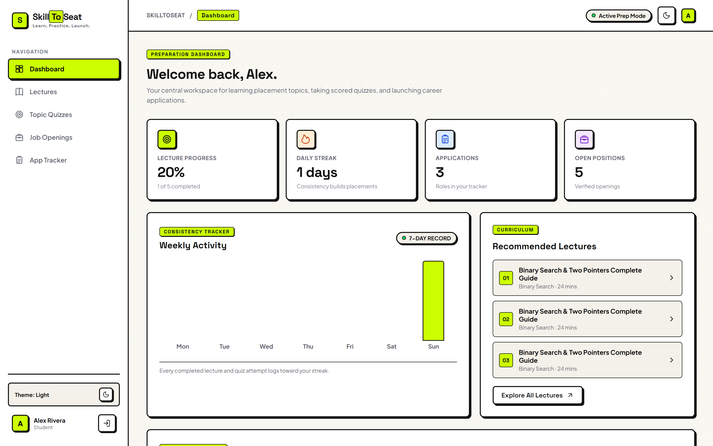
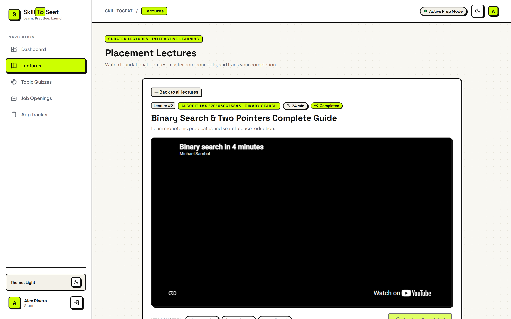
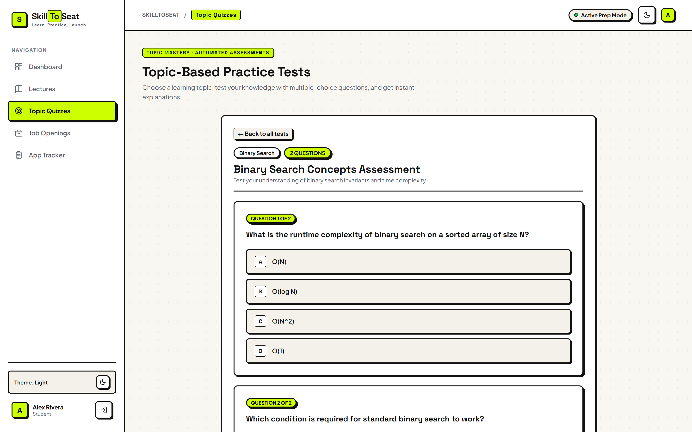
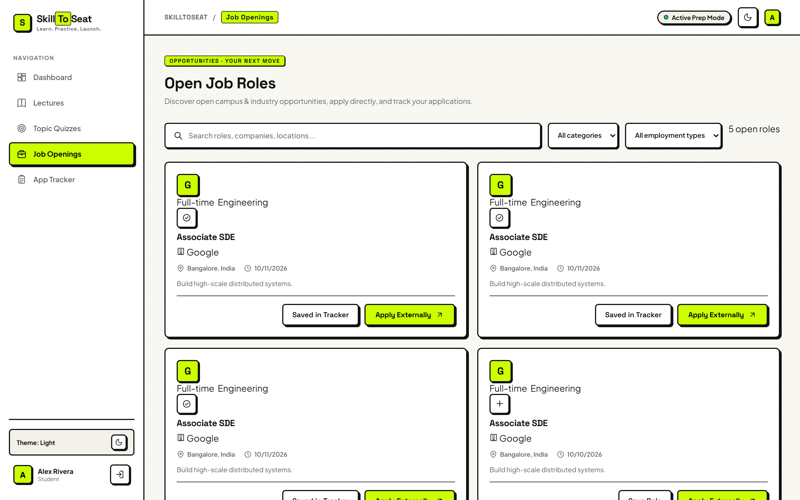
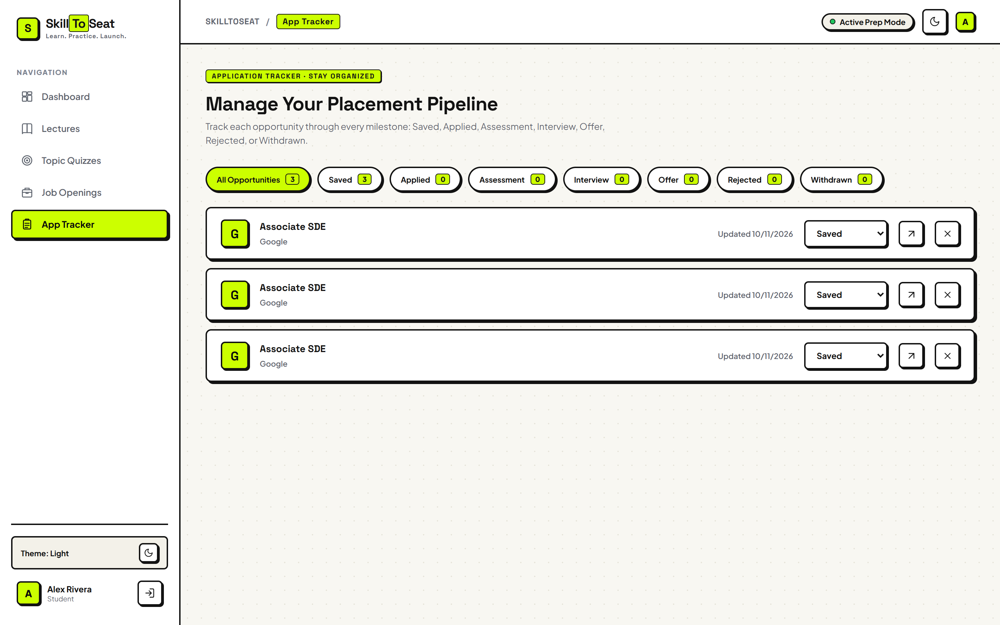
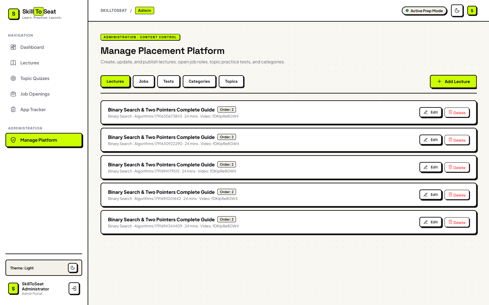
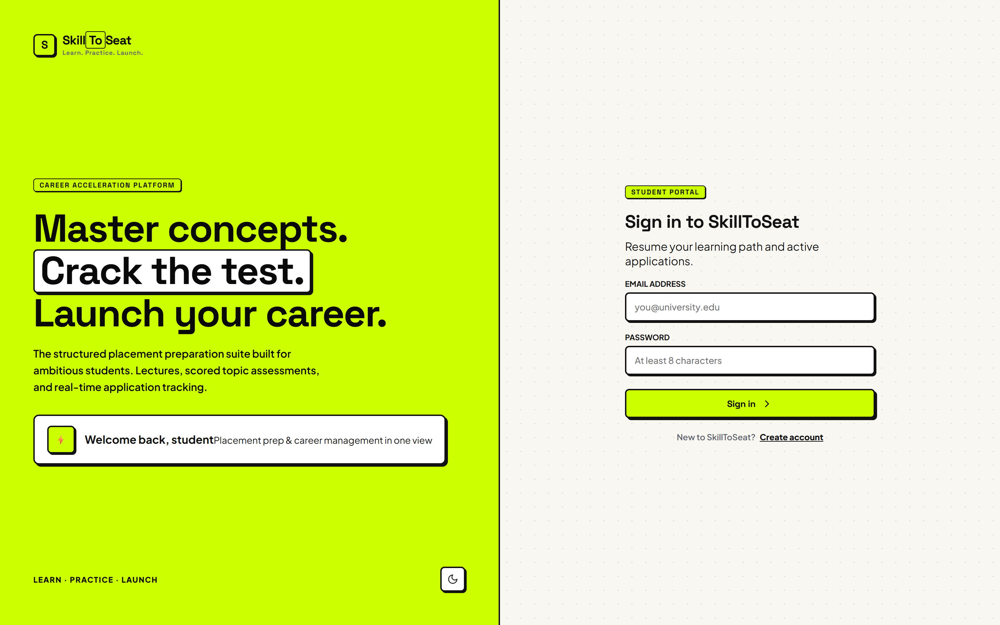

# SkillToSeat

> **Learn. Practice. Launch.**  
> An all-in-one student placement preparation and career management platform.

SkillToSeat is a full-stack MERN application engineered to accelerate student placement readiness. It brings together structured topic-based curriculum learning, interactive YouTube lectures, automated practice test assessments with server-side scoring, verified campus and industry job listings, and an end-to-end 7-stage application tracking pipeline. The application is styled in a distinctive **Neo-Brutalist** design system featuring high-contrast borders, tactile offset shadows, a warm off-white canvas, electric lime accents, and persistent Light/Dark theme switching.

---

## ⚡ Features

### 1. Curated Placement Lectures
- **Topic & Category Browsing**: Organize and filter foundational placement content across core computer science categories and specific topics.
- **Embedded YouTube Video Player**: Responsive, high-fidelity player embedded directly in each lesson page with conceptual overview badges.
- **Real-Time Progress Tracking**: One-click completion marking updates student metrics, logs daily consistency streaks, and records progress in MongoDB.
- **Integrated Knowledge Checks**: Interactive topic quizzes embedded directly underneath each lecture for instant concept reinforcement.

### 2. Topic-Based Assessments & Automated Scoring
- **Curriculum-Aligned Practice Tests**: Multiple-choice assessments tailored to topics such as Binary Search, Dynamic Programming, and System Design.
- **Client-Side Security Masking**: Questions are served without sensitive fields (`answerIndex`, `explanation`) to prevent client-side inspection.
- **Automated Server-Side Evaluation**: Immediate scoring upon submission, computing percentage grades, pass/retry status, and revealing detailed conceptual explanations.
- **Attempt & Mastery Tracking**: Tracks attempt counts, preserves personal best scores, and rewards consistency by updating the user's daily study streak.

### 3. Open Job Roles Directory
- **Verified Opportunities**: Campus and off-campus listings displaying company name, role title, location, employment type (Full-time, Internship), and date posted.
- **Search & Multi-Filter**: Real-time keyword filtering across roles, companies, and locations, alongside category and employment type dropdowns.
- **Status Safeguards**: Closed job postings are automatically hidden from student search results.
- **One-Click Tracking**: Direct external application links and one-click saving of opportunities directly into the student's Application Tracker.

### 4. 7-Stage Placement Application Tracker
- **Comprehensive Lifecycle Management**: Full pipeline tracking across all **7 placement milestones**:
  - `Saved` — Initial bookmarking of interest
  - `Applied` — Application submitted to company
  - `Assessment` — Online assessment / coding challenge received
  - `Interview` — Technical or behavioral interview in progress
  - `Offer` — Placement offer extended
  - `Rejected` — Not selected
  - `Withdrawn` — Candidate withdrew application
- **Interactive Stage Badges**: Real-time counter pills showing exact application volume per milestone.
- **In-Place Updates**: Inline dropdown selectors to update application status instantly without leaving the dashboard.

### 5. Student Dashboard & Consistency Analytics
- **At-a-Glance Metrics**: Four high-contrast statistics cards displaying Lecture Completion %, Active Daily Streak, Tracked Applications, and Total Open Positions.
- **7-Day Consistency Tracker**: An interactive weekly activity chart displaying daily learning velocity.
- **Recent Assessment Performance**: Summaries of recent quiz attempts with score percentages and attempt counts.
- **Recommended Next Lessons**: Dynamic curriculum recommendations guiding students to continue their learning journey.

### 6. Administration Content Management Portal
- **Role-Based Access Control**: Protected dashboard accessible exclusively to authenticated users with the `ADMIN` role.
- **Tabbed Management Modules**:
  - **Lectures**: Create, edit, and delete lectures with title, description, category, topic, YouTube video ID/URL, duration, and display sequence.
  - **Jobs**: Post and manage job listings with company, title, location, employment type, description, external apply URL, and toggle Open/Closed status.
  - **Quizzes**: Build topic quizzes with multiple-choice questions (2 to 6 options), correct answer index, and server-side explanations.
  - **Categories**: Manage placement categories and display order.
  - **Topics Hub**: Aggregated oversight of topic distribution across lectures and quizzes with quick-add shortcuts.

### 7. Neo-Brutalist Design System & Theme Engine
- **Aesthetic Identity**: Tactile neo-brutalist styling built with pure Vanilla CSS, utilizing a warm off-white canvas (`#f8f7f2`), subtle dot background grid, deep near-black borders (`#121212`), hard offset box-shadows (`3px 3px 0px #121212`), and electric lime action accents (`#ccff00`).
- **Persistent Theme Toggle**: Seamless Light / Dark mode toggle located in the navigation header, persistent in `localStorage` under `skilltoseat_theme`.
- **Responsive Layout**: Designed mobile-first with adaptive CSS Grid and Flexbox layouts.

---

## 📸 Application Screenshots

The screenshots below are captured directly from the live SkillToSeat application.

### 1. Student Dashboard & Consistency Analytics
The central hub for students, displaying lecture completion percentage, daily study streaks, application counts, a 7-day activity chart, and recommended curriculum lectures.


### 2. Curated Lecture & Embedded Video Player
Lesson view featuring an embedded YouTube player, concept tags, one-click completion tracking, and an integrated topic quiz directly beneath the lecture.


### 3. Topic-Based Practice Test Runner
Interactive multiple-choice test runner with questions, answer options A–D, timer/status badges, and server-side automated scoring with explanations.


### 4. Verified Open Job Roles
The job directory offering real-time search, category and employment type filters, direct company links, and one-click saving to the student's pipeline.


### 5. 7-Stage Placement Application Tracker
The structured interview pipeline tracking roles across Saved, Applied, Assessment, Interview, Offer, Rejected, and Withdrawn with real-time status counters.


### 6. Administrator Content Management Portal
The administration panel providing full CRUD content control over Lectures, Open Jobs, Topic Quizzes, Categories, and the Topics Hub.


### 7. Authentication & Onboarding
The split-canvas neo-brutalist authentication screen with warm canvas styling, electric lime accents, student portal badges, and quick sign-in.


---

## 🛠 Technologies Used

### Frontend
- **React 18** — Component-driven user interface architecture
- **Vite 6** — Lightning-fast development server and optimized production bundler
- **React Router 7** — Client-side declarative routing and protected route guards
- **Recharts** — Responsive SVG charting for the 7-day consistency tracker
- **Vanilla CSS** — Custom Neo-Brutalist design system with CSS custom properties and theme tokens

### Backend
- **Node.js** — Asynchronous JavaScript runtime environment
- **Express 4** — RESTful API routing, rate limiting, and middleware architecture
- **Mongoose 8** — Schema modeling and validation for MongoDB
- **JSON Web Tokens (JWT)** — Stateless, secure authentication via HTTP-only cookies
- **bcryptjs** — Password hashing with cryptographic salt rounds
- **Helmet & CORS** — HTTP security headers and cross-origin resource sharing configuration
- **express-rate-limit** — Abuse prevention and endpoint rate limiting

### Database & Resilience
- **MongoDB Atlas** — Production-grade cloud NoSQL database
- **MongoDB Memory Server (`mongodb-memory-server`)** — Built-in zero-configuration in-memory fallback database ensuring local development works out-of-the-box even if cloud database connectivity is unavailable
- **Windows DNS Fallback** — Native PowerShell DNS resolution patch in Node to prevent SRV lookup timeouts on Windows environments

---

## 🚀 Installation & Setup

### Prerequisites
- **Node.js**: v20.x or higher
- **npm**: v10.x or higher
- **MongoDB**: Optional (embedded in-memory MongoDB automatically spins up if no external MongoDB URI is reachable)

### 1. Clone the Repository
```bash
git clone https://github.com/omjadhav9641/-SkillToSeat.git
cd -SkillToSeat
```

### 2. Install Dependencies
Install all root, client, and server dependencies with a single command:
```bash
npm install
```

### 3. Configure Environment Variables
Copy the example environment configuration in the `server` directory:
```bash
cp server/.env.example server/.env
```

Edit `server/.env` with your preferred settings. **Never commit real credentials or production secret keys to version control.**

#### Environment Variable Reference (`server/.env`):
| Variable | Required | Description | Example / Default |
| :--- | :---: | :--- | :--- |
| `PORT` | Optional | Backend API port | `5000` |
| `CLIENT_URL` | Optional | Frontend application origin for CORS | `http://localhost:5173` |
| `MONGODB_URI` | Optional | MongoDB Atlas or local connection string | `mongodb+srv://<user>:<password>@cluster.mongodb.net/placement-platform` |
| `JWT_SECRET` | Required | Cryptographic secret for signing auth tokens | `your_super_secret_jwt_key_here` |
| `NODE_ENV` | Optional | Runtime environment (`development` or `production`) | `development` |
| `ADMIN_EMAIL` | Optional | Seed email for default administrator | `admin@skilltoseat.internal` |
| `ADMIN_PASSWORD` | Optional | Seed password for default administrator | `AdminPassword123!` |
| `STUDENT_EMAIL` | Optional | Seed email for default student | `student@skilltoseat.internal` |
| `STUDENT_PASSWORD`| Optional | Seed password for default student | `StudentPassword123!` |

> **Note on Database Connection**: If `MONGODB_URI` is omitted or unable to connect, the server automatically starts an internal in-memory MongoDB instance (`mongodb-memory-server`). No manual database configuration is required to test the project locally.

---

## 💻 How to Run the Application

### Development Mode (Recommended)
Run both frontend and backend concurrently from the project root:
```bash
npm run dev
```
- **Frontend App**: [http://localhost:5173](http://localhost:5173)
- **Backend API**: [http://localhost:5000](http://localhost:5000)
- **Health Check**: [http://localhost:5000/api/health](http://localhost:5000/api/health)

### Running Workspaces Individually
- **Client only**:
  ```bash
  npm run dev -w client
  ```
- **Server only**:
  ```bash
  npm run dev -w server
  ```

### Production Build
To create an optimized production build of the React frontend:
```bash
npm run build
```

To run the production Node.js server:
```bash
npm run start
```

---

## 🔑 Demo Accounts & Admin Setup

### Pre-Seeded Demo Accounts
On initial launch, the system automatically seeds default accounts for instant evaluation:

| Role | Email | Password | Access Rights |
| :--- | :--- | :--- | :--- |
| **Administrator** | `admin@skilltoseat.internal` | `AdminPassword123!` | Full CRUD on Lectures, Jobs, Tests, Categories, Topics |
| **Student** | `student@skilltoseat.internal` | `StudentPassword123!` | Dashboard, Lectures, Quizzes, Job Listings, Application Tracker |

### Promoting an Account to Admin
If you register a new account through the application UI and wish to promote it to an administrator:
1. Set the email in `server/.env`:
   ```env
   ADMIN_EMAIL=your_email@example.com
   ```
2. Run the admin promotion script:
   ```bash
   npm run seed:admin -w server
   ```

---

## 🧪 Testing & Verification

The project includes an end-to-end API test script that validates the full stack against the running database:

```bash
cd server
node test_features.mjs
```

### What the Test Suite Verifies:
1. **Authentication & Roles**: Admin login, student registration, role validation, and JWT cookie management.
2. **Lecture Management**: Creation of categories and lectures with YouTube URLs, student lecture retrieval, and completion tracking.
3. **Open Job Roles**: Job creation, active filtering (hiding closed listings), and saving roles into the student's Application Tracker.
4. **Topic Assessments & Security**: Test creation, verification that client payloads mask `answerIndex` and `explanation`, automated server-side scoring, and streak logging.
5. **Data Integrity & Cleanup**: Retrieval of student progress records and post-test teardown.

---

## 🤖 AI Development Experience (Code0)

This project was built and refined with assistance from **Code0**, an AI coding assistant. Throughout the development lifecycle, I leveraged Code0 as a pair-programming partner while actively reviewing, understanding, adapting, and validating all architecture choices, code suggestions, and security implementations.

### 5 Specific Tasks Code0 Assisted With:

1. **Neo-Brutalist Visual Design System & Theme Engine**:  
   Code0 helped architect the custom CSS design system, defining the tactile neo-brutalist tokens (warm off-white canvas `#f8f7f2`, 2px solid `#121212` borders, `3px 3px 0px #121212` offset shadows, and `#ccff00` electric lime accents). It also structured the `ThemeContext` provider to persist the Light/Dark theme state in `localStorage`. I reviewed the styling rules and adjusted component margins, responsive grid break-points, and typography hierarchies across all screens.

2. **Curated Lectures & Embedded Knowledge Reinforcement**:  
   Code0 assisted with integrating responsive YouTube video embeds into the `Learn` module and embedding topic-based quizzes directly underneath the lecture player. I examined the React component lifecycle to ensure that marking a lecture complete updates both the student's progress and the 7-day consistency streak without requiring a page refresh.

3. **Topic-Based Assessment Engine & Server-Side Security Masking**:  
   Code0 helped construct the multi-choice quiz runner in React and implemented the backend security masking logic in Express. When students fetch a test, sensitive fields (`answerIndex`, `explanation`) are explicitly stripped by the API. I inspected the schema and controller logic to ensure that quiz scoring happens strictly server-side upon submission, preventing client-side inspection vulnerabilities.

4. **7-Stage Placement Application Pipeline**:  
   Code0 assisted in extending the job application tracker into a standardized 7-stage workflow (`Saved`, `Applied`, `Assessment`, `Interview`, `Offer`, `Rejected`, `Withdrawn`), complete with real-time status count pills and inline status selectors. I verified the API routes and Mongoose query filters to ensure that status transitions and deletions are scoped strictly to the authenticated user.

5. **MongoDB Resilience & Windows DNS Troubleshooting**:  
   When connecting to MongoDB Atlas on Windows, DNS SRV resolution timeouts occurred within Node's `c-ares` resolver. Code0 helped identify the root cause and implement a native PowerShell DNS resolver fallback alongside an automatic fallback to `mongodb-memory-server`. It also helped write the end-to-end integration test suite (`server/test_features.mjs`), which I executed to verify all API endpoints against the live database.

By thoroughly inspecting, testing, and refining Code0's suggestions at every step, I maintained complete control over code quality, security standards, and the user experience.
